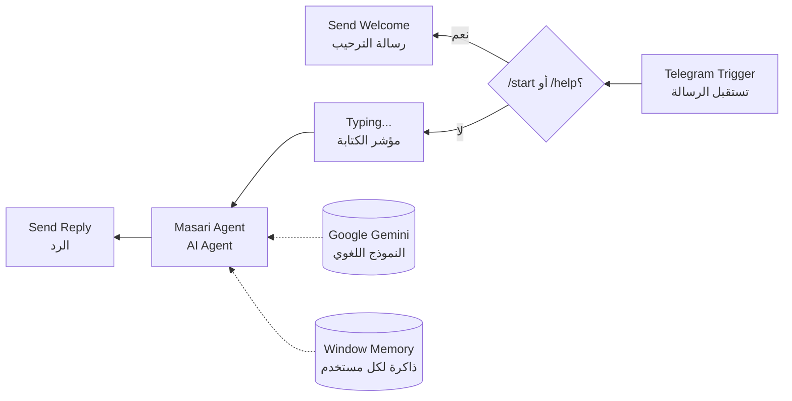
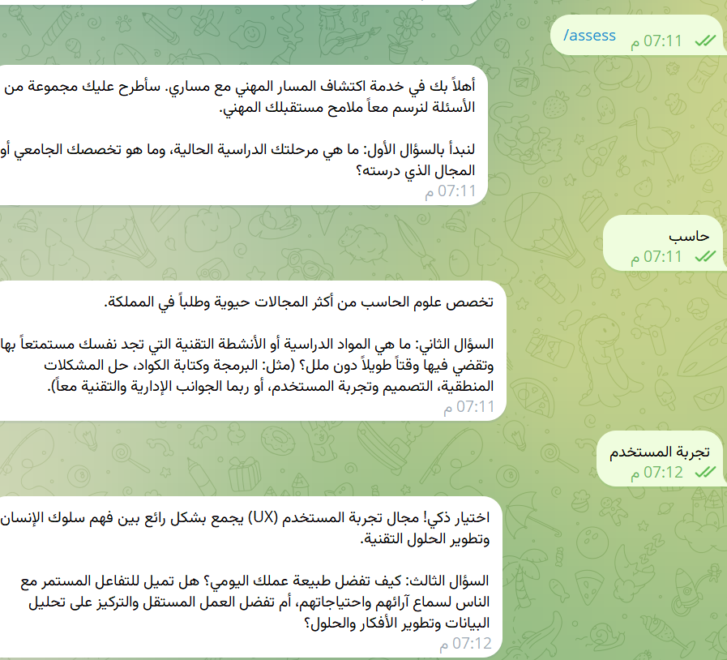
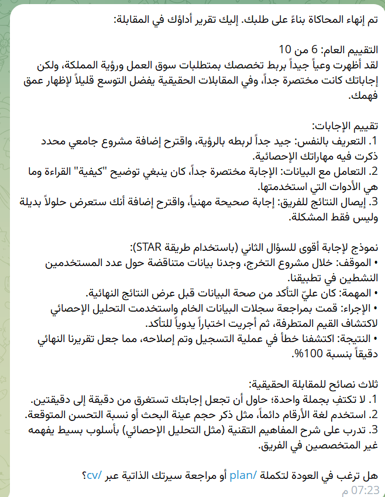
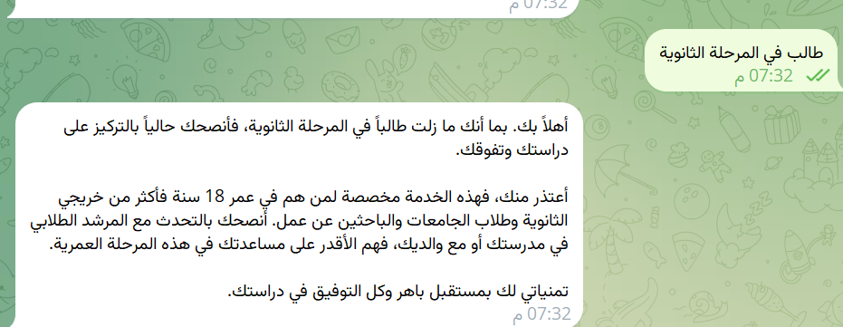

# مساري · Masari

**مرشدك المهني الذكي على تليجرام**

وكيل ذكاء اصطناعي يساعد الخريجين والباحثين عن عمل على اكتشاف مسارهم المهني، ومراجعة سيرهم الذاتية، والتدرب على المقابلات، وبناء خطة تعلم. مبني بالكامل على **n8n** بدون كتابة كود.

---

## الفكرة

كثير من الخريجين يعرفون ما درسوا، ولا يعرفون أين يتجهون. والإرشاد المهني الجيد يحتاج وقتاً وجلسات فردية لا تتوفر لكل من يحتاجها. **مساري** يقدّم هذا الإرشاد في محادثة واحدة على تليجرام، بالعربية، ومجاناً.

## الخدمات

| الأمر | الخدمة | ما يحصل عليه المستخدم |
|---|---|---|
| `/assess` | اكتشف مسارك | محادثة من 6 إلى 8 أسئلة، ثم تقرير بثلاثة مسارات مهنية في سوق العمل السعودي، لكل منها المهارات المطلوبة وشهادة للبدء وخطوة عملية |
| `/interview` | محاكاة مقابلة عمل | مقابلة من 6 أسئلة، ثم تقييم من 10 وملاحظة على كل إجابة ونموذج إجابة بطريقة STAR |
| `/cv` | مراجعة السيرة الذاتية | تقييم عام، وأهم 5 تحسينات مع إعادة صياغة، والكلمات المفتاحية الناقصة لأنظمة ATS |
| `/plan` | خطة تعلم | 3 إلى 4 مراحل لكل منها مخرج ملموس، ومشروع تطبيقي لملف الأعمال |
| `/end` | إنهاء المقابلة | يستلم المستخدم تقرير المقابلة فوراً |

يتذكر مساري ما قاله المستخدم خلال المحادثة، فتبني كل خدمة على ما قبلها دون تكرار الأسئلة.

## كيف يعمل

سير عمل من ثماني عقد على n8n. تعليمات الوكيل كاملة في [`prompts/system-prompt.md`](prompts/system-prompt.md).

## ضوابط التصميم

- **الدقة:** لا يخترع أرقام رواتب أو شروط قبول، ويحيل المستخدم دائماً إلى المصادر الرسمية.
- **الخصوصية:** ينبّه المستخدم ألا يشارك رقم هويته أو أي بيانات حساسة، ولكل مستخدم ذاكرة منفصلة.
- **الفئة العمرية:** الخدمة لمن هم 18 سنة فأكثر، ومن هو دون ذلك يُوجَّه بلطف إلى المرشد الطلابي ووالديه.

## لقطات

## التشغيل

1. أنشئ بوتاً من [@BotFather](https://t.me/BotFather) واحصل على التوكن.
2. احصل على مفتاح Gemini API من [Google AI Studio](https://aistudio.google.com).
3. استورد [`workflow/masari-workflow.json`](workflow/) في n8n، واربط الحسابين، ثم انشر سير العمل.

الخطوات التفصيلية وحل المشكلات في [`guides/setup-guide.md`](guides/setup-guide.md).

## محتويات المستودع

| المسار | المحتوى |
|---|---|
| `workflow/` | سير عمل n8n الجاهز للاستيراد |
| `prompts/` | تعليمات الوكيل ورسالة الترحيب وقائمة الأوامر |
| `guides/` | دليل التشغيل خطوة بخطوة |
| `docs/` | صفحة المشروع (تُنشر عبر GitHub Pages) |
| `assets/` | الشعار واللقطات والفيديوهات الترويجية |
| `video-source/` | مصدر الفيديوهات الترويجية (رسوم HTML وموسيقى مولّدة برمجياً) |

## الخطوات القادمة

- [ ] قراءة السيرة الذاتية مباشرة من ملف PDF أو صورة
- [ ] حفظ الملف المهني لكل مستخدم في قاعدة بيانات
- [ ] ذاكرة دائمة تبقى بعد إعادة تشغيل الخادم
- [ ] حد يومي للرسائل لضبط الاستخدام

---

فكرة وتصميم وتنفيذ **أريج عطاالله الجبرتي** · 2026

---

<b>English summary</b>

**Masari** is an Arabic AI career-guidance agent on Telegram for graduates and job seekers (18+) in Saudi Arabia. Built entirely in **n8n** with no code: Telegram Trigger → AI Agent (Google Gemini + per-user window memory) → reply.

Commands: `/assess` (career path discovery with a 3-path report), `/interview` (6-question mock interview with a STAR-based report), `/cv` (CV review with ATS keyword gaps), `/plan` (staged learning plan).

Guardrails: no invented salaries or admission requirements, privacy reminders, and an 18+ age policy that politely redirects younger users to their school counselor.

Try it: [t.me/MasariCareerBot](https://t.me/MasariCareerBot)

